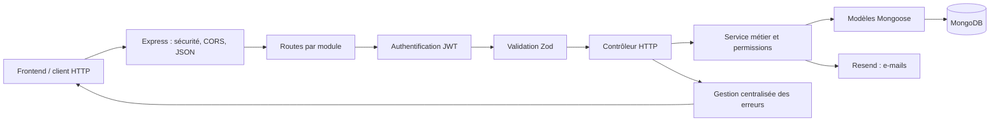
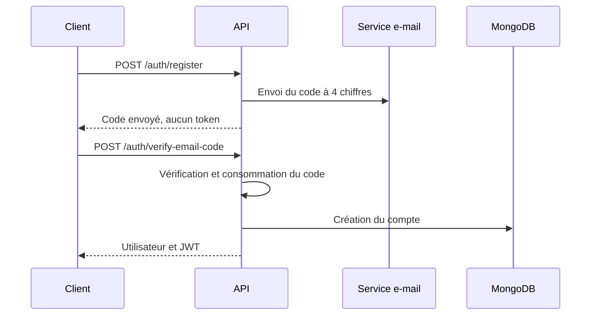

# TaskFlow — Backend API

API REST de TaskFlow, une application de gestion de tâches et de projets inspirée de Jira. Le backend gère l’authentification par JWT, la vérification e-mail, les équipes, les rôles, les projets, les tickets, le Kanban, les commentaires, l’historique et le tableau de bord.

## Technologies

- Node.js 20+
- Express 5 et TypeScript
- MongoDB avec Mongoose
- Zod pour la validation
- JWT et bcrypt pour l’authentification
- Resend pour les e-mails
- Jest et Supertest pour les tests
- Swagger / OpenAPI pour la documentation HTTP

## Installation

Prérequis : Node.js 20+, npm et MongoDB.

```bash
npm install
cp .env.example .env
```

Variables principales à renseigner dans `.env` :

```dotenv
NODE_ENV=development
PORT=3000
CORS_ORIGIN=http://localhost:5173
MONGODB_URI=mongodb://127.0.0.1:27017/taskflow
MONGODB_TEST_URI=mongodb://127.0.0.1:27017/taskflow_test
JWT_SECRET=une-cle-secrete-longue-et-aleatoire
JWT_EXPIRES_IN=24h
RESEND_API_KEY=re_xxxxxxxxx
RESEND_FROM_EMAIL="TaskFlow <onboarding@resend.dev>"
EMAIL_VERIFICATION_TTL_MINUTES=10
```

En production, `RESEND_FROM_EMAIL` doit utiliser une adresse ou un domaine validé chez Resend.

## Démarrage

```bash
# Développement avec rechargement automatique
npm run dev

# Compilation et démarrage en production
npm run build
npm start
```

Adresses utiles avec le port `3000` :

- API : `http://localhost:3000/api`
- Santé : `http://localhost:3000/api/health`
- Swagger : `http://localhost:3000/api/docs`
- OpenAPI JSON : `http://localhost:3000/api/docs.json`

## Architecture



Chaque domaine suit la structure `routes → validation → controller → service → model`. La logique métier et les autorisations restent dans les services, tandis que les contrôleurs ne gèrent que le protocole HTTP.

## Inscription et authentification

L’inscription nécessite la validation de l’adresse e-mail :



- `POST /api/auth/register` valide le formulaire et envoie le code.
- `POST /api/auth/send-verification-code` renvoie le code après le délai de sécurité.
- `POST /api/auth/verify-email-code` crée le compte et retourne `{ user, token }` si le code est correct.
- `POST /api/auth/login` connecte un compte existant.

Les routes privées attendent ensuite :

```http
Authorization: Bearer <token>
```

## Principaux domaines de l’API

| Domaine | Préfixe |
|---|---|
| Authentification | `/api/auth` |
| Profil et utilisateurs | `/api/users` |
| Tâches personnelles | `/api/tasks` |
| Équipes et membres | `/api/teams` |
| Projets | `/api/projects` |
| Fonctionnalités | `/api/features` |
| Tickets et Kanban | `/api/tickets` |
| Commentaires | `/api/comments` et `/api/tickets/:id/comments` |
| Tableau de bord | `/api/dashboard` |

Le détail des méthodes, paramètres et réponses est disponible dans Swagger.

## Vérifications

```bash
npm run typecheck
npm run lint
npm test
npm run build
```

Les tests utilisent exclusivement `MONGODB_TEST_URI`. Par sécurité, le nom de cette base doit se terminer par `_test`.

## Documentation du code

Le fonctionnement détaillé de chaque couche et de chaque module est présenté dans [DOCUMENTATION_CODE.md](./DOCUMENTATION_CODE.md). Les fichiers TypeScript contiennent également des commentaires courts sur leur responsabilité et sur les règles métier sensibles.
